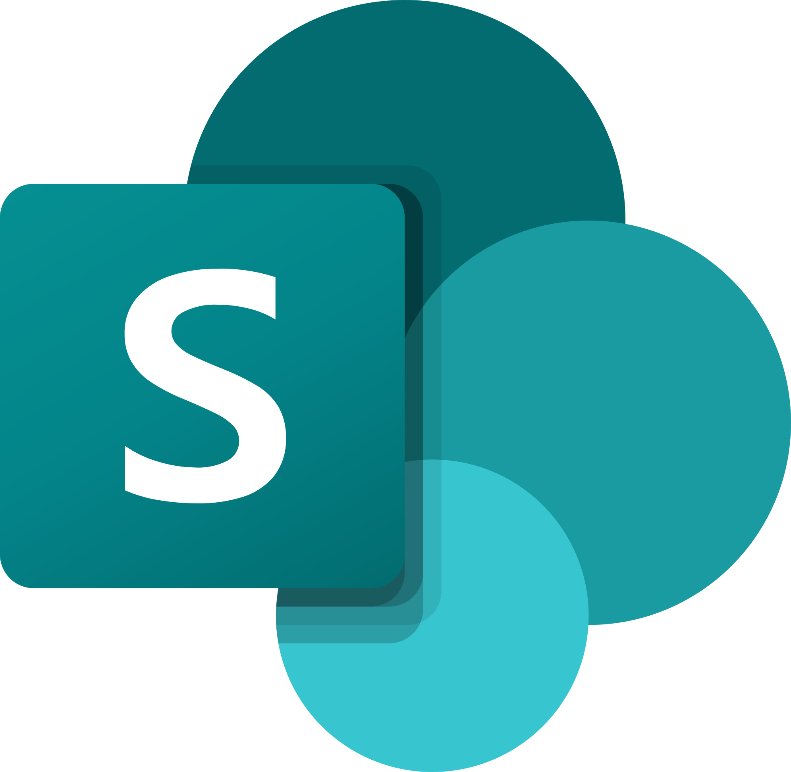

# lrh-m365-auth

Shared Microsoft sign-in for the local Outlook, Teams, and SharePoint connectors. The library
keeps each product's client/resource profile in one encrypted MSAL cache under the same Windows
user profile. Any connector's explicit `auth` command checks every supported profile, silently
reuses accepted credentials, and requests device-code approval only for a profile that needs it.
Microsoft can still require more than one approval because the connectors use different public
clients and resource audiences.

The `outlook.graph` profile requests delegated Graph `Mail.Read` and `User.Read`: mailbox reads use
the former, while Outlook's signed-in profile and photo use the latter. The additional profile
permission does not establish access to OneDrive or SharePoint files.

The cache is for one active Microsoft account. Switching accounts requires the connector's
`auth --sign-out` command followed by `auth`; the account-state marker makes already-running
processes discard in-memory tokens on their next acquisition. Encryption is mandatory by default.

Offline status reports whether each OAuth client has a cached refresh credential and when a
matching resource access token expires, if one is cached. Profiles that share a client can show the
same client-credential state even when only one resource token is cached. `status --check` attempts
token acquisition for each profile; only an operation against the owning service can establish
service access.

The `m365.search` profile requests the separate Outlook-host Search resource used by the verified
Search v2 calendar and Teams-message queries. It uses the same first-party client as `outlook.api`
but has a distinct resource token; approval for one resource does not prove the other is available.

Connectors bind the token source used by a service context to that context's account. If another
process switches accounts, later API requests from the old context fail with an account mismatch
instead of mixing the new account's remote data with the old account's local store.

This package does not make Microsoft Graph, Outlook, or Teams requests. It does not exchange Teams
tokens for a Chat Service session, read browser cookies, run a daemon, or refresh tokens in the
background.

## Product boundaries

This repository is part of the `lrh-*` Microsoft 365 connectors: local tools that give MCP agents
access to a common corporate environment, its mail and calendar, chats and meetings, and files. Each
repository owns one product, and all of them share one sign-in.

| | Repository | Responsible for |
|---|---|---|
|  | [lrh-m365-auth](https://github.com/lucasrhode95/lrh-m365-auth) | Shared Microsoft sign-in: one encrypted token cache and the profiles every connector uses |
|  | [lrh-outlook-connector](https://github.com/lucasrhode95/lrh-outlook-connector) | Exchange mail, folders, drafts, rules, native signatures, and calendar events (schedule, agenda, attendees, Teams join link) |
|  | [lrh-teams-connector](https://github.com/lucasrhode95/lrh-teams-connector) | Teams chats and channels, message attachments, and meeting chats, recordings, transcripts, recaps and notes |
|  | [lrh-sharepoint-connector](https://github.com/lucasrhode95/lrh-sharepoint-connector) | General OneDrive and SharePoint file search and selected file retrieval (read-only) |

A calendar event stays with Outlook even when it links to a Teams meeting; Teams owns that meeting's
chat and artifacts. A file linked from an email or a Teams message stays part of that message, while
the stored file itself is retrieved through SharePoint. Only verified identifiers connect records
across products.

> [!WARNING]
> These tools sign in as Microsoft's own apps and use undocumented Outlook and Teams services.
> Giving an AI agent access to your work mail, chats or files may break your organization's policies
> on AI use and data handling, so check with your IT or security team first. The tools are provided
> as is, without warranty, and the authors are not responsible for any misuse or its consequences.
> Microsoft, Outlook, Teams, SharePoint and Entra are trademarks of Microsoft; this project is not
> affiliated with or endorsed by Microsoft.

## Development

```powershell
uv sync --locked
uv run ruff check .
uv run ruff format --check .
uv run pyright
uv run pytest
```

Tests use synthetic accounts and fake identity-provider responses. They never contact Microsoft.

## License

Copyright 2026 Lucas Rhode. This is source-available software, not open source: the code is public
so anyone can read and audit it. The [PolyForm Strict License 1.0.0](LICENSE.md) allows use for
noncommercial purposes only, such as personal study, research, hobby projects, or work at a
charitable, educational or government organization. It does not allow commercial use, including use
for your job at a company, and it does not allow distributing, changing, or building on the
software.
